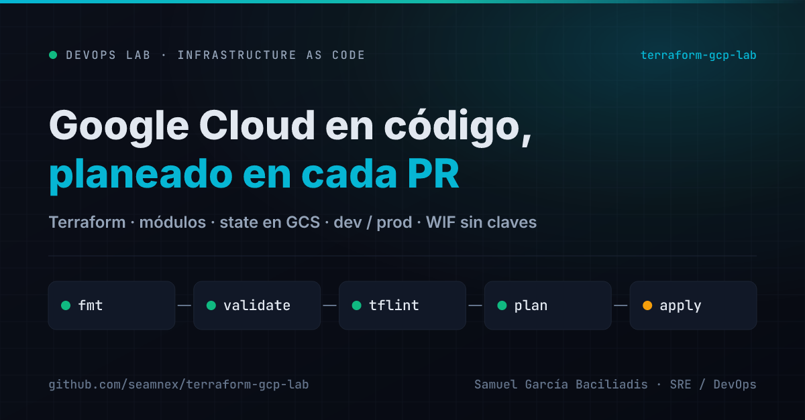
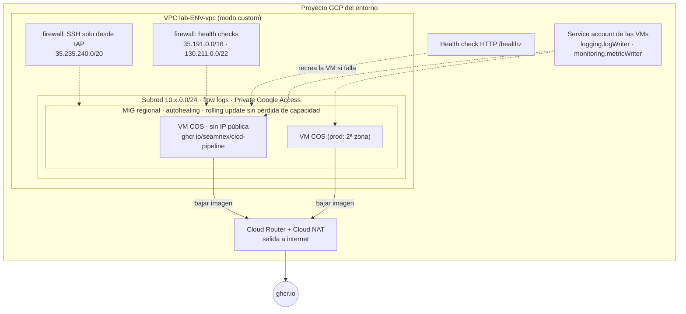
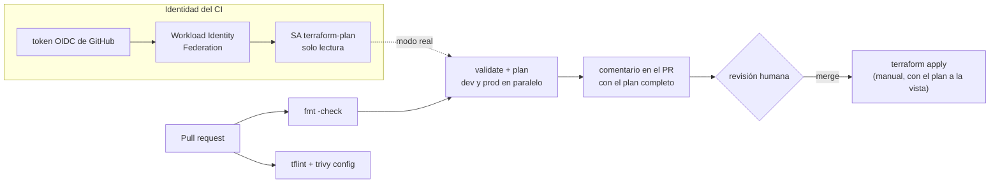

# Terraform GCP Lab — Infraestructura que se revisa antes de existir

[](https://github.com/seamnex/terraform-gcp-lab/actions/workflows/terraform.yml)



Infraestructura en Google Cloud definida con Terraform: módulos reutilizables
de red, IAM y cómputo, state remoto en GCS, entornos `dev` y `prod`, y un
workflow que corre `fmt`, `validate`, `tflint` y `plan` en cada pull request.

> Parte de mi ruta de especialización en SRE / DevOps.
> Contexto: en gestión de incidentes, el cambio manual en la consola —el que
> nadie revisó y nadie anotó— es una de las causas que más se repiten. Acá
> practico la alternativa: que la infraestructura cambie solo por PR.

> **Estado honesto de este lab.** Todo el código se validó y se planeó, pero
> **todavía no se aplicó contra una cuenta real de GCP**. Los planes de esta
> bitácora son *offline*: muestran qué se crearía, no qué existe. Los pasos
> para aplicarlo con una cuenta propia están más abajo.

---

## El problema

"¿Quién abrió ese puerto?" "¿Por qué prod tiene una VM más que dev?" "¿Esto lo
creó alguien a mano?". En un War Room, si la infraestructura no está en código,
estas preguntas no tienen respuesta, o la tienen en la memoria de una persona
que está de vacaciones.

Y el problema espejo: infraestructura en código que nadie revisa antes de
aplicar. Un `terraform apply` sin plan revisado es un cambio a ciegas con
mejor tipografía.

## La solución

- **Módulos chicos con una sola responsabilidad** (`network`, `iam`, `compute`),
  reutilizados por los dos entornos. dev y prod difieren **solo** en sus `tfvars`.
- **State remoto** en un bucket de GCS con versionado y locking: dos personas
  no pueden aplicar a la vez, y un state roto se recupera de la versión anterior.
- **Cada PR muestra su plan** como comentario, para que la revisión sea sobre
  el efecto real del cambio y no solo sobre el diff del código.
- **El CI nunca aplica.** Planea con una identidad que solo puede leer; el
  apply lo hace una persona.

---

## Arquitectura

Lo que crea cada entorno (12 recursos):



Y cómo llega un cambio desde el PR hasta GCP:



### Entornos

| | dev | prod |
|---|---|---|
| Zonas | 1 (`us-central1-a`) | 2 (`us-central1-a`, `-b`) |
| VMs | 1 × `e2-micro` | 2 × `e2-small` |
| Disco | `pd-standard` 10 GB (free tier) | `pd-balanced` 10 GB |
| Flow logs | 10 %, cada 10 min | 50 %, cada 5 s |
| Subred | `10.10.0.0/24` | `10.20.0.0/24` |
| State | `gs://<bucket>/terraform-gcp-lab/dev` | `gs://<bucket>/terraform-gcp-lab/prod` |

### Decisiones que vale la pena explicar

**Ninguna VM tiene IP pública.** Entran solo SSH por IAP (autenticado con la
identidad de Google y OS Login) y los health checks de Google. Salen por Cloud
NAT. No hay puerto 22 abierto a internet en ningún entorno.

**La service account de las VMs no es la default.** La de Compute Engine por
defecto tiene rol **Editor** sobre el proyecto: una VM comprometida podría
borrar todo lo demás. Esta solo escribe logs y métricas, y el módulo tiene una
validación que rechaza `owner`, `editor` o roles para emitir credenciales,
aunque alguien los ponga en un `tfvars`.

**`google_project_iam_member`, nunca `_policy`.** `_policy` es autoritativo
sobre el proyecto entero: el primer `apply` borraría todos los permisos que
Terraform no conoce, incluidos los de quien lo está corriendo.

**MIG aun con una sola VM.** El grupo administrado recrea la VM si el health
check falla y hace rolling updates sin bajar de la capacidad declarada
(`max_unavailable = 0`). Una VM suelta que se cuelga espera a que alguien se despierte.

**El CI entra a GCP sin claves.** Con Workload Identity Federation, el runner
presenta un token OIDC firmado por GitHub y GCP lo cambia por credenciales de
corta duración. No hay JSON de service account guardado en ningún secreto. El
pool **solo acepta tokens de este repo** (`attribute_condition`), que es el
error más común —y más grave— al configurar WIF.

---

## Costos estimados

Precios de lista en `us-central1`, 730 horas por mes, **sin impuestos**. Los de
Cloud NAT y disco los tomé de las páginas oficiales de precios de Google
([NAT](https://cloud.google.com/nat/pricing), [discos](https://cloud.google.com/compute/disks-image-pricing));
los de las VMs E2, de agregadores que publican la lista de SKUs de Google.
**Verificalos en la [calculadora oficial](https://cloud.google.com/products/calculator)
antes de aplicar: los precios cambian.**

| Concepto | Precio unitario | dev | prod |
|---|---|---|---|
| VM `e2-micro` | ~$0,0084/h | **$0** (free tier¹) | — |
| VM `e2-small` | ~$0,0168/h | — | 2 × $12,26 = $24,53 |
| Disco de arranque 10 GB | `pd-balanced` $0,10/GB-mes | **$0** (`pd-standard`, free tier¹) | 2 × $1,00 = $2,00 |
| Cloud NAT — gateway | $0,0014/h por VM | $1,02 | $2,04 |
| Cloud NAT — IP externa | $0,005/h por IP | $3,65 | $3,65 |
| Cloud NAT — datos procesados | $0,045/GiB | ~$0,05 (≈1 GiB²) | ~$0,05 |
| Bucket del state | — | centavos | (compartido) |
| **Total por mes** | | **≈ $4,72** | **≈ $32,27** |
| **Total por hora** | | ≈ $0,0065 | ≈ $0,044 |

¹ El [free tier](https://cloud.google.com/free/docs/free-cloud-features) cubre
**una** `e2-micro` no-Spot por cuenta de facturación en `us-central1`,
`us-east1` o `us-west1`, y 30 GB-mes de disco **standard** (no balanced). Si ya
tenés otra `e2-micro` corriendo, dev pasa a costar ≈ $10,85.
² Estimación: bajar la imagen (~55 MB) en cada recreación de VM más
actualizaciones del SO. No está medido.

**Lo que no está en la tabla:** los VPC flow logs y los logs del NAT se cobran
como ingesta de Cloud Logging. Para un lab sin tráfico deberían quedar dentro de
la cuota gratuita mensual, pero no lo medí.

> **El costo dominante de dev no es la VM: es la IP del NAT.** $3,65 de $4,72.
> Si el objetivo fuera bajar más el costo, la palanca sería esa —por ejemplo,
> sacar el NAT y bajar la imagen desde Artifact Registry por Private Google
> Access— y no achicar la máquina.

---

## Requisitos

Para validar y planear (sin cuenta de GCP):

- **Terraform 1.16.6** —o Docker con `hashicorp/terraform:1.16.6`—
- Opcional: **tflint 0.64.0** y **Trivy 0.76.1**

Para aplicar de verdad:

- Una cuenta de Google Cloud con facturación, y dos proyectos (dev y prod)
- **gcloud CLI** autenticado con tu cuenta

## Cómo ejecutarlo

### Validar y planear sin cuenta de GCP

Es lo mismo que hace el CI en modo offline:

```bash
git clone https://github.com/seamnex/terraform-gcp-lab.git
cd terraform-gcp-lab

terraform fmt -check -recursive

cd envs/dev
cp ../../ci/backend_override.tf .        # backend local, solo para esta prueba
terraform init
terraform validate
GOOGLE_OAUTH_ACCESS_TOKEN=offline terraform plan -refresh=false -lock=false
# Plan: 12 to add, 0 to change, 0 to destroy.
rm backend_override.tf
```

> `GOOGLE_OAUTH_ACCESS_TOKEN=offline` no es una credencial: el provider de
> Google exige *alguna* para inicializarse, y con `-refresh=false` contra un
> state vacío no hace ninguna llamada a la API.

### Aplicar con tu cuenta (pasos que no ejecuté)

> **Esto crea recursos que cuestan dinero.** Ver [Costos estimados](#costos-estimados).

**1. Bootstrap** — una sola vez, con tu identidad:

```bash
gcloud auth application-default login
gcloud services enable compute.googleapis.com iam.googleapis.com \
  iamcredentials.googleapis.com sts.googleapis.com storage.googleapis.com \
  --project=<tu-proyecto-admin>

cd bootstrap
cp terraform.tfvars.example terraform.tfvars   # completar
terraform init
terraform apply
terraform output                              # anotar los tres valores
```

En dev y prod habilitá también `compute.googleapis.com` e `iam.googleapis.com`.

**2. Backend** — en `envs/dev/backend.tf` y `envs/prod/backend.tf`, reemplazá
`REEMPLAZAR-tfstate` por el bucket del output (o pasalo con
`terraform init -backend-config="bucket=<bucket>"`). En cada `terraform.tfvars`,
reemplazá `project_id`.

**3. Dev:**

```bash
cd envs/dev
terraform init
terraform plan -out=tfplan
terraform apply tfplan
```

Verificar que la app responde, sin IP pública, a través de IAP:

```bash
gcloud compute instances list --filter="labels.entorno=dev"
gcloud compute ssh <vm> --zone us-central1-a --tunnel-through-iap \
  --command "curl -s localhost:8080/api/v1/status"
```

**4. Plan real en el CI** — en el repo de GitHub, *Settings → Secrets and
variables → Actions → Variables*, crear:

| Variable | Valor |
|---|---|
| `GCP_WIF_PROVIDER` | output `wif_provider` del bootstrap |
| `GCP_SA_PLAN` | output `ci_service_account` |
| `TF_STATE_BUCKET` | output `bucket_state` |
| `TF_PROJECT_DEV` / `TF_PROJECT_PROD` | IDs de tus proyectos |

Son variables, no secretos: ninguna da acceso por sí sola. Con
`GCP_WIF_PROVIDER` definida, el workflow pasa solo de modo offline a modo real.

### Destruir todo

En orden inverso, y **mirando el plan de destrucción antes de confirmar**:

```bash
cd envs/prod && terraform destroy
cd ../dev    && terraform destroy
```

El bootstrap está protegido a propósito (`prevent_destroy` y
`force_destroy = false`): el bucket guarda el state de todo lo demás. Para
eliminarlo, una vez destruidos dev y prod:

```bash
# 1. sacar la protección: en bootstrap/main.tf, prevent_destroy = false
# 2. vaciar el bucket, incluidas las versiones viejas
gcloud storage rm --recursive --all-versions gs://<bucket>/**
# 3. destruir
cd bootstrap && terraform destroy
```

Verificación final de que no quedó nada facturando:

```bash
gcloud compute instances list --project=<proyecto>
gcloud compute addresses list --project=<proyecto>
gcloud compute routers list --project=<proyecto>
```

> El pool de Workload Identity queda en estado "eliminado" 30 días antes de
> borrarse del todo, y su ID no se puede reutilizar en ese lapso. Si volvés a
> correr el bootstrap antes, cambiá `workload_identity_pool_id`.

---

## Bitácora

**Entorno:** Windows 11 · Docker Desktop 29.6.2 · `hashicorp/terraform:1.16.6`
· provider `hashicorp/google` 8.8.1 · `tflint` 0.64.0 con ruleset Google 0.40.0
· Trivy 0.76.1. **Fecha:** 05/11/2026.

| Verificación | dev | prod | bootstrap | módulos |
|---|---|---|---|---|
| `terraform fmt -check` | ✅ | ✅ | ✅ | ✅ |
| `terraform validate` | ✅ | ✅ | ✅ | (vía entornos) |
| `terraform plan` offline | ✅ 12 a crear | ✅ 12 a crear | ✅ 8 a crear (valores del `.example`) | — |
| `tflint` | ✅ 0 hallazgos | ✅ 0 | ✅ 0 | ✅ 0 |
| `trivy config` | 63 controles OK | 63 OK | 67 OK · **1 LOW** | — |

**El "0 hallazgos" de tflint lo verifiqué rompiéndolo.** Un linter que nunca
vi fallar es un linter que no sé si está mirando. Cambié `e2-micro` por
`e2-microo` en el `tfvars` de dev y tflint lo detectó **a través del módulo**:

```
envs/dev/main.tf:35:27: Error - "e2-microo" is an invalid as machine type
(google_compute_instance_template_invalid_machine_type)
```

`terraform validate` no lo detecta —para él es un string válido— y el plan
offline tampoco. Sin tflint, ese error aparecía recién en el `apply`, contra la API.

**El único hallazgo de Trivy está aceptado, con motivo.** `GCP-0066` (LOW): el
bucket del state usa la clave de cifrado de Google y no una administrada por
mí (CMEK). CMEK suma una clave de Cloud KMS, su rotación y el riesgo de que
borrar la clave deje el state ilegible. Para un lab, ese riesgo es mayor que el
beneficio. En un entorno regulado la decisión sería la inversa.

<!-- CI-BITACORA -->

### Lo que no está probado

- **Ningún `apply`.** No hay recursos reales: no sé si el cloud-init arranca el
  contenedor en COS a la primera, ni cuánto tarda una VM en pasar el health check
  (los 180 s de gracia del autohealing son una estimación, no una medición).
- **El modo real del CI** (WIF + state en GCS) no corrió nunca: requiere el bootstrap.
- **Los costos** son cálculos sobre precios de lista, no una factura.

---

## Qué me llevo de este lab

**1. El plan offline valida el código, no la infraestructura.** Saber que el
plan dice "12 to add" prueba que el código es coherente. No prueba que la API
acepte esos recursos, que las cuotas alcancen ni que el firewall deje pasar el
health check. Es tentador poner un tilde verde y decir "Terraform funciona";
lo honesto es decir qué valida cada capa y qué queda afuera.

**2. Las validaciones de variables son documentación que se ejecuta.** El
`validation` que rechaza `roles/editor` en la service account de las VMs es la
misma regla que pondría en una wiki, pero esta no se puede ignorar. Las reglas
que dependen de que alguien se acuerde se rompen a las 3 AM.

**3. El costo dominante casi nunca es el que uno espera.** Antes de hacer la
cuenta habría apostado a que lo caro de dev era la VM. Es la IP del NAT.
Optimizar sin medir habría llevado a achicar la máquina, que ya era gratis.

**4. Lo que no se puede borrar por accidente necesita estar declarado.** El
bucket del state tiene `prevent_destroy`, y destruirlo requiere tres pasos
explícitos. Es fricción a propósito: perder el state es perder el mapa de qué
recursos existen, y ese incidente no se resuelve con un rollback.

---

## Próximos pasos

- [ ] Correr el bootstrap y el apply de dev con una cuenta real, y registrar los tiempos en la bitácora
- [ ] Medir cuánto tarda una VM nueva en pasar el health check y ajustar `gracia_autohealing_seg`
- [ ] Agregar un balanceador HTTP delante del MIG (hoy el MIG no recibe tráfico externo)
- [ ] Detección de drift: un `plan` programado que avise si alguien cambió algo a mano en la consola
- [ ] Reemplazar Cloud NAT por Artifact Registry + Private Google Access y medir el ahorro

## Estructura

```
terraform-gcp-lab/
├── .github/workflows/
│   └── terraform.yml        # fmt, tflint, trivy, validate + plan (dev y prod) en cada PR
├── bootstrap/               # bucket de state + WIF + SA de plan (se aplica una vez, a mano)
├── ci/
│   └── backend_override.tf  # backend local para el plan offline del CI
├── envs/
│   ├── dev/                 # backend, providers, llamada a módulos, terraform.tfvars
│   └── prod/
├── modules/
│   ├── network/             # VPC, subred, Cloud NAT, firewall IAP + health checks
│   ├── iam/                 # service account de las VMs con roles mínimos
│   └── compute/             # instance template COS + MIG regional + health check
├── docs/card.png
└── .tflint.hcl
```

## Licencia

MIT
